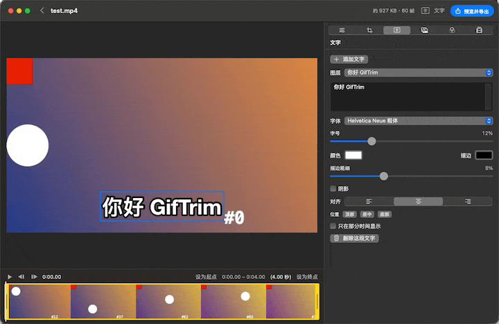
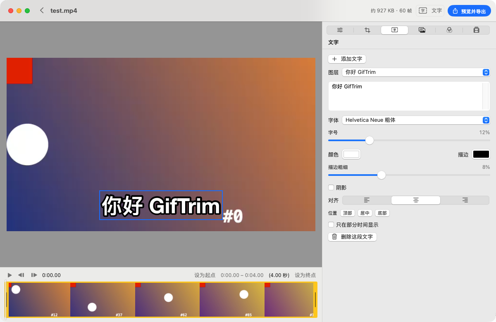
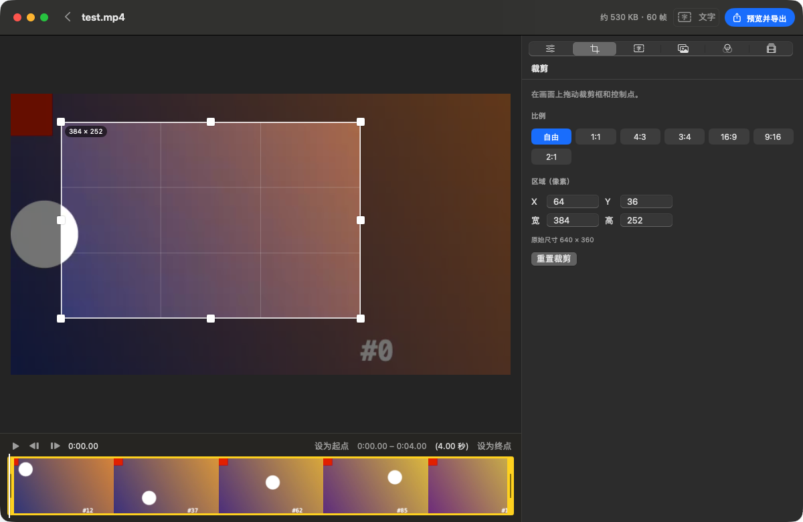
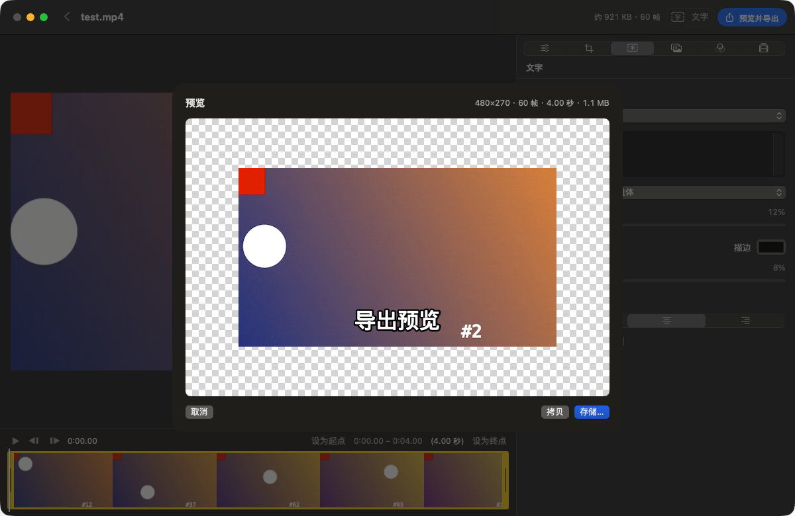
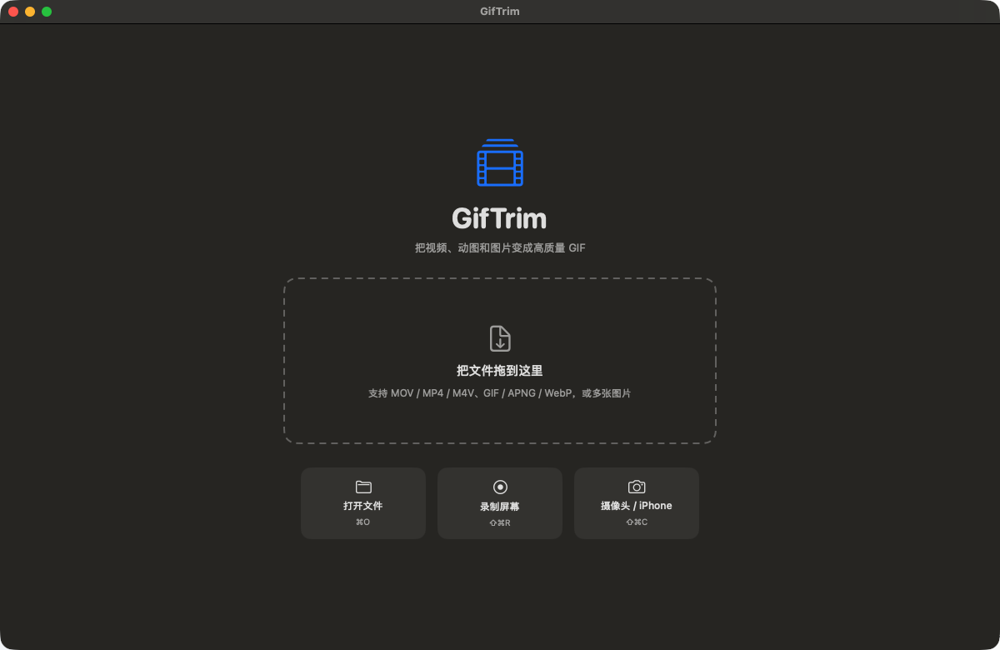

<p align="center">
  
</p>

<h1 align="center">GifTrim</h1>

<p align="center">
  <b>在 Mac 上做又清晰又小的 GIF，也可以交给你的 AI 助手来做。</b><br>
  视频转 GIF · 录屏 / iPhone 录制 · 字幕 · 裁剪 · 目标大小 · 命令行 · MCP
</p>

<p align="center">
  <a href="https://github.com/swsususu/GifTrim/releases/latest"></a>
  
  
  <a href="docs/AI.md#简体中文"></a>
  <a href="LICENSE"></a>
  <a href="https://github.com/swsususu/GifTrim/stargazers"></a>
</p>

<p align="center">
  <a href="README.md">English</a> | 简体中文
</p>

<p align="center">
  
  <br><sub>这张 GIF 由 GifTrim 自己录制并编码。</sub>
</p>

GifTrim 是 GIF Brewery 的免费开源替代品。你可以拖入视频、录屏、GIF/APNG/WebP 动图或一组图片，
截取、裁剪、加字幕后导出**清晰又小**的 GIF。编码器是 [gifski](https://gif.ski)，它基于 pngquant 做跨帧调色板优化，
每帧能用上千种颜色，不会出现常见的 256 色色块。

GifTrim 也**为 AI 而设计**。它自带本地 MCP 服务和 Agent Skill，Claude、Cursor、VS Code Copilot、Codex 等 AI 助手都能直接帮你做 GIF：

> “把桌面上最新的录屏做成 2MB 以内的 GIF 放 README，加字幕「拖动排序」。”

## 为什么选 GifTrim

| | GifTrim | 常见在线转换工具 |
|---|---|---|
| 画质 | gifski，每帧可用上千种颜色 | 256 色抖动 |
| 隐私 | 完全本地处理，不上传 | 需要上传视频 |
| 大小控制 | 实时估算，可设**目标大小**（如 ≤ 2MB） | 只能反复试 |
| 录制 | 屏幕区域、摄像头、**USB 连接的 iPhone** | — |
| 自动化 | `--json` 命令行、JSON 任务、**MCP 服务**、Agent Skill | — |
| 价格 | 免费，GPL-3.0 | 广告、水印或订阅 |

## 功能

<table>
<tr>
<td width="50%"></td>
<td width="50%"></td>
</tr>
<tr>
<td align="center"><sub>时间轴截取、字幕拖动定位、大小实时估算</sub></td>
<td align="center"><sub>按固定比例裁剪（1:1、16:9、9:16…）</sub></td>
</tr>
<tr>
<td width="50%"></td>
<td width="50%"></td>
</tr>
<tr>
<td align="center"><sub>预览就是最终 GIF，显示真实文件大小</sub></td>
<td align="center"><sub>拖入文件、录屏，或用摄像头 / iPhone 录制</sub></td>
</tr>
</table>

- **输入**：MOV / MP4 / M4V；GIF / APNG / WebP；多张图片（按文件名排序成序列）
- **录制**：
  - 录屏（ScreenCaptureKit）：拖选区域或录整个屏幕，自动排除 GifTrim 自己的窗口
  - 摄像头和 Continuity Camera
  - **USB 连接的 iPhone / iPad 屏幕**
- **截取**：带缩略图的时间轴和截取手柄。快捷键：`I` / `O` 设起点和终点，`空格` 播放，`←` / `→` 逐帧
- **裁剪**：在画面上拖动裁剪框，可锁定比例，也可输入精确像素
- **字幕**：
  - 支持多段文字，在画面上拖动定位
  - 可调字体、字号、颜色、描边、阴影和对齐
  - 可设置只在某段时间显示
- **贴图 / 水印**：PNG 或 Logo，可调大小、不透明度和显示时段
- **滤镜**：13 种效果（黑白、怀旧、漫画等），以及亮度、对比度、饱和度、锐化和暗角
- **输出**：
  - 宽度、帧率（最高 50 fps）、速度（0.25 到 4 倍）
  - 正放、倒放，或**来回播放**做成无缝循环
  - 循环次数、画质、有损压缩、运动质量、快速编码
  - 预设，以及**按目标大小自动适配**
- **逐帧编辑**：删除、复制、排序，或单独设置某一帧的时长
- **拷贝粘贴**：复制 GIF 后可以直接粘贴到微信、Slack、GitHub、Notion

## 🤖 给 AI 用

AI 可以通过三种方式使用 GifTrim，全部在本机运行。

**1. MCP 服务**：支持 Claude Desktop / Code、Cursor、VS Code、Windsurf、Codex、Kilo 等客户端。

```bash
claude mcp add giftrim -- /Applications/GifTrim.app/Contents/Helpers/giftrim mcp
```

```json
{ "mcpServers": { "giftrim": { "command": "/Applications/GifTrim.app/Contents/Helpers/giftrim", "args": ["mcp"] } } }
```

也可以在菜单栏选择 **GifTrim → 为 AI 助手配置 MCP…**，一键复制配置。

| 工具 | 作用 |
|---|---|
| `get_media_info` | 读取时长、尺寸和帧率 |
| `preview_frame` | 以**图片**形式返回一帧编辑后的画面，AI 可以先看裁剪和字幕效果，再决定是否编码 |
| `estimate_gif` | 大约一秒内预测文件大小 |
| `make_gif` | 完成整个制作，并汇报进度 |

**2. Agent Skill**：把 [`skills/giftrim`](skills/giftrim/SKILL.md) 复制到 `~/.claude/skills/` 或 `~/.agents/skills/`。

**3. 以 JSON 为主的命令行**：所有命令都支持 `--json`，也可以通过管道传入完整的任务：

```bash
giftrim info demo.mov --json
giftrim demo.mov -o demo.gif --start 3 --end 12 --width 720 --text "拖动排序" --target-size 2048 --json
echo '{"inputs":["/abs/demo.mov"],"aspect":"1:1","mode":"bounce"}' | giftrim run - --json
```

完整的接入说明见 **[docs/AI.md](docs/AI.md#简体中文)**，另有 [llms.txt](llms.txt)。

## 安装

**Homebrew**（同时会链接 `giftrim` 命令）：

```bash
brew install --cask swsususu/tap/giftrim
```

**DMG**：从 [Releases](https://github.com/swsususu/GifTrim/releases/latest) 下载 `GifTrim_x.y.z_universal.dmg`，把 GifTrim 拖进“应用程序”。

应用目前只做了 ad-hoc 签名，**尚未公证**，第一次打开时会被 macOS 拦截。处理方法：右键点击应用选择“打开”，或者在终端执行：

```bash
xattr -dr com.apple.quarantine /Applications/GifTrim.app
```

权限：

- 录屏：在“系统设置 › 隐私与安全性 › 屏幕与系统录音”中允许 GifTrim，然后重新打开应用。
- 摄像头：第一次使用时会弹出授权请求。

## 使用说明

1. **打开**：把文件拖到窗口或 Dock 图标上，或按 `⌘O`。也可以录屏（`⇧⌘R`），或用摄像头 / iPhone 录制（`⇧⌘C`）。
2. **截取**：拖动黄色手柄，或者在播放头位置按 `I` / `O`。
3. **编辑**：在右侧的“输出 / 裁剪 / 文字 / 贴图 / 滤镜 / 帧”面板中调整，工具栏会实时显示预计大小。
4. **导出**（`⌘E`）：先生成真实的 GIF 并播放，确认后选择“存储…”或“拷贝”。

小技巧：

- README 或 PR 演示：宽度 800、12 fps、有损 70。
- 聊天软件限制大小时：用“输出 → 目标大小”。
- 想要无缝循环：选“来回”播放。
- 文件太大：依次降低帧率、减小宽度、开启有损压缩。

## 命令行

```text
giftrim <输入...> -o out.gif [选项]     转换
giftrim info <文件>                     查看信息
giftrim estimate <输入...> [选项]       预测大小
giftrim snapshot <输入...> -o f.png     预览一帧编辑后的画面
giftrim run <job.json | ->              执行 JSON 任务（格式见 giftrim schema）
giftrim mcp                             启动 MCP 服务
```

在菜单栏选择 **GifTrim → 安装命令行工具 giftrim…**，即可在终端中直接使用。

## 从源码构建

需要 Xcode 或 Command Line Tools（Swift 6），以及用于编译 gifski 的 Rust（`rustup`）。

```bash
git clone --recursive https://github.com/swsususu/GifTrim.git
cd GifTrim
make gifski   # 编译通用 libgifski.a
make test     # 运行单元测试
make app      # 生成 build/GifTrim.app
make dmg      # 生成 build/GifTrim_0.1.1_universal.dmg
```

## 路线图

- [ ] Developer ID 签名与公证
- [x] 应用内检查更新（GifTrim → 检查更新…）
- [ ] 英文界面（命令行和 MCP 已经是英文）
- [ ] 项目保存与恢复
- [ ] 导出 MP4 / WebP / APNG
- [ ] 录屏时高亮鼠标点击

欢迎提交 Issue 和 PR。如果 GifTrim 帮你省了时间，**点个 ⭐ 能让更多人找到它。**

## 致谢与许可

GifTrim 以 [GPL-3.0-or-later](LICENSE) 发布。它静态链接了 Kornel Lesiński 的 [gifski](https://github.com/ImageOptim/gifski)（AGPL-3.0-or-later），
二者依据 GPLv3 / AGPLv3 第 13 条组合。详见 [THIRD_PARTY_NOTICES.md](THIRD_PARTY_NOTICES.md)。
